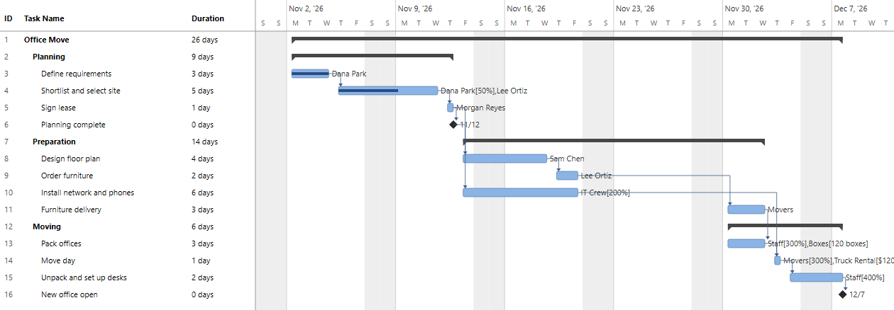

<h1 align="center">PlanCraft — ribbon edition</h1>

<p align="center">
  <b>A desktop project scheduler that opens your Microsoft Project files.</b><br>
  Ribbon, Gantt chart, critical path and resource leveling, written entirely in Rust,<br>
  and built so a script or an AI agent can do anything you can click.
</p>

<p align="center">
  
  
  
  
</p>

<p align="center">
  <a href="#download"><b>Download</b></a> ·
  <a href="#features">Features</a> ·
  <a href="#opening-microsoft-project-files">Opening .mpp files</a> ·
  <a href="#build-and-run">Build and run</a> ·
  <a href="#getting-started">Get started</a> ·
  <a href="#drive-it-from-scripts-and-ai-agents">Scripts and AI agents</a>
</p>

<p align="center">
  <a href="https://github.com/musgravebrenner/ProjectCraft/releases/latest"><b>⬇ Download PlanCraft for Windows</b></a>
</p>

<br>



<table>
  <tr>
    <td width="25%" valign="top">
      <h3>📂 Opens .mpp files</h3>
      Open your existing Microsoft Project plans (2010 and later) and they open with tasks, outline, links, constraints, resources and assignments intact.
    </td>
    <td width="25%" valign="top">
      <h3>📋 Familiar by design</h3>
      A ribbon with Task, Resource, Report, Project, View and Format tabs, a File screen and thirteen views, laid out where you'd expect them.
    </td>
    <td width="25%" valign="top">
      <h3>⚡ Native and fast</h3>
      A native Rust app (egui). No browser, no Electron, no account, and your plans stay as files on your own disk.
    </td>
    <td width="25%" valign="top">
      <h3>🤖 Every click is a command</h3>
      All 747 commands are shared by the window, the command line, a JSON control channel and an MCP server, so agents get the whole app, not a subset.
    </td>
  </tr>
</table>

<br>

## Download

PlanCraft is free. Get the latest version from the **[Releases page](https://github.com/musgravebrenner/ProjectCraft/releases/latest)**: under **Assets**, download `PlanCraft-<version>-windows-x64.zip`. It runs on Windows 10 or 11, 64-bit.

1. Right-click the zip in your Downloads folder, choose **Extract All…**, and pick where to keep PlanCraft.
2. Open the extracted folder and double-click **plancraft.exe**.

There's nothing to install. **The first time you open it**, Windows may show a blue box saying *"Windows protected your PC"*. This is SmartScreen warning about an app it hasn't seen often. Click **More info**, then **Run anyway**.

The folder also contains `plancraft-cli.exe`, the command line and MCP server described [below](#drive-it-from-scripts-and-ai-agents). There are no macOS or Linux downloads yet; on those, [build it from source](#build-and-run).

## How this relates to PlanCraft

This repository is a fork of [rallegretti/PlanCraft](https://github.com/rallegretti/PlanCraft), but the code on `main` is a **separate code base**, started independently with the same goal: a free, native replacement for a desktop project scheduler. The original project's code is kept on the [`upstream-main`](../../tree/upstream-main) branch for comparison.

The biggest difference is that this edition **reads `.mpp` files directly**. PlanCraft exchanges plans through Microsoft Project XML.

## Features

### Plan your project

- Type tasks straight into the task sheet, indent them under summary tasks, and fill values down the selection.
- Link tasks Finish-to-Start, Start-to-Start, Finish-to-Finish or Start-to-Finish, with leads and lags.
- Use all eight constraint types (As Soon As Possible, Must Start On, Start No Earlier Than and the rest), and add deadlines.
- Choose Fixed Units, Fixed Duration or Fixed Work task types. Durations can be elapsed (`3ed`), so they run around the clock.
- Mix automatic and manually scheduled tasks. Recurring tasks and subprojects are also supported.
- See the **critical path** and total slack, calculated with a full forward and backward pass. [MECHANICS.md](MECHANICS.md) spells out every rule.

### Thirteen views

Gantt Chart, Tracking Gantt, Task Sheet, Task Usage, Network Diagram, Calendar, Timeline, Task Form, Resource Sheet, Resource Usage, Resource Form, Resource Graph and Team Planner. Each comes with filters, grouping, sorting and your own columns and custom fields.

### People, costs and leveling

- Use work, material and cost resources, each with a standard rate, cost per use and maximum units.
- Work and cost are calculated from assignments and the task type.
- Resources that are overallocated are flagged. **Level All** delays the lower-priority work until no one is overbooked.
- Working-time calendars include the Standard, 24 Hours and Night Shift calendars, plus your own exceptions.

### Track progress

- Save up to **eleven baselines** (Baseline through Baseline 10) and compare them in the Tracking Gantt.
- Set a status date and update the project as of that date.
- Run **14 built-in reports**: Project Overview, Cost Overview, Work Overview, Cash Flow, Resource Overview, Overallocated Resources, Critical Tasks, Late Tasks, Milestones, Upcoming Tasks, Slipping Tasks, Deadlines, Not Started and Completed.

### Print, export and share

- Print any view with a live preview, or save it as a **PDF**.
- Export to Microsoft Project XML, CSV, HTML (a report with the chart), SVG (a picture of the Gantt chart) and Markdown.

### Make it yours

- Light, dark or follow-the-system theme.
- Gantt chart style gallery, bar formatting and fonts in the Format tab.
- Start from one of five templates: Software Development Plan, Commercial Construction, Event Planning, Marketing Campaign and Office Move.
- The **Command Palette** (`Ctrl+Shift+P`) finds any of the 747 commands by name.

## Opening Microsoft Project files

Open a `.mpp` or `.mpt` file with **File ▸ Open**, or with `plancraft-cli run plan.mpp`. Files from Microsoft Project 2010 and later are read; these are the ones with the `114` storage layout. It opens as a new plan, and you save it as `.plan.json`.

| Comes across | Not read yet |
|---|---|
| Tasks, names, notes and WBS codes | Calendars (the Standard calendar is used instead) |
| Outline levels and summary tasks | Baselines |
| Durations, start, finish and % complete | Custom fields |
| Milestones, manual and inactive tasks | Password-protected files |
| Constraints, deadlines and priorities | Files from Project 2007 or older (re-save them in a newer version) |
| Links with their type and lag | |
| Work, material and cost resources, with rates and max units | |
| Assignments with units, work and cost | |

The reader was checked against Microsoft Project's own XML export of the same plans: `cargo run --example mppcheck -- mpptest/*.mpp` matches 1072 of 1072 values across four test plans. [MECHANICS.md](MECHANICS.md#reading-mpp-files-srcmpprs) describes the file layout record by record. Writing `.mpp` files isn't supported. To send a plan back to Microsoft Project, export it as XML.

## Build and run

To build it yourself instead of [downloading it](#download), you need [Rust](https://rustup.rs). On Windows you also need the Visual Studio C++ build tools.

```bash
git clone https://github.com/musgravebrenner/ProjectCraft.git
cd ProjectCraft
cargo build --release
```

Then start the window or the command line:

```bash
./target/release/plancraft            # the app
./target/release/plancraft-cli --help # the command line
```

On Windows with more than one Visual Studio installed, you may need a `.cargo/config.toml` that points at the linker you use. It isn't committed, because it is specific to each machine.

It has been developed and tested on Windows. egui also runs on macOS and Linux, but those haven't been tried yet.

## Getting started

1. **Try the sample.** Run `plancraft-cli new --sample --out office.plan.json` and open it, or pick **Office Move** from the templates under **File ▸ New**.
2. **Open your own plan.** Use **File ▸ Open** on a `.mpp`, `.xml` or `.plan.json` file.
3. **Add tasks.** Press `Insert` and type a name and a duration such as `3d`.
4. **Organize.** Use `Alt+Shift+→` to indent tasks under a summary task.
5. **Link.** Select tasks in order and press `Ctrl+F2`.
6. **Assign people.** Press `Alt+F10`, or type names in the *Resource Names* column.
7. **Track.** Save a baseline from the Project tab, then follow progress in the Tracking Gantt.

### Keyboard shortcuts

| Shortcut | Does |
|---|---|
| `Insert` / `Delete` | Insert a task / delete the selected task |
| `Alt+Shift+→` / `Alt+Shift+←` | Indent / outdent |
| `Alt+Shift+↑` / `Alt+Shift+↓` | Move a task up / down |
| `Ctrl+F2` / `Ctrl+Shift+F2` | Link / unlink the selected tasks |
| `Shift+F2` | Task Information |
| `Ctrl+Shift+M` / `Ctrl+Shift+A` | Manually schedule / auto schedule |
| `Alt+F10` | Assign resources |
| `Ctrl+Shift+F3` | Level all resources |
| `F9` | Recalculate the project |
| `Ctrl+D` | Fill down |
| `Ctrl+F` / `Ctrl+H` | Find / replace |
| `F5` | Go to a task |
| `Ctrl+Shift+F5` | Scroll the chart to the selected task |
| `Ctrl+=` / `Ctrl+-` | Zoom the timeline in / out |
| `Ctrl+B` / `Ctrl+I` / `Ctrl+U` | Bold / italic / underline |
| `Ctrl+Z` / `Ctrl+Y` | Undo / redo |
| `Ctrl+N` / `Ctrl+O` / `Ctrl+S` / `F12` | New / open / save / save as |
| `Ctrl+P` | Print |
| `Ctrl+Shift+P` | Command Palette |
| `F1` | Help |

## Drive it from scripts and AI agents

Every ribbon button, menu item and dialog runs a command from one registry. `plancraft-cli` runs the same commands without a window, and every subcommand explains itself with `--help`.

```bash
# Open a plan, add a task, assign people, save a baseline, write the result
plancraft-cli run office.plan.json \
  --cmd task.insert        --params '{"name":"Paint walls","duration":"3d","predecessors":"5"}' \
  --cmd resource.assign    --params '{"ids":[6],"resource":"Painters","units":200}' \
  --cmd project.baseline.set.0 \
  --out office-final.plan.json

# Turn a Microsoft Project file into a CSV task table or a Gantt chart picture
plancraft-cli run plan.mpp --out plan.csv
plancraft-cli run plan.mpp --out plan.svg

# Apply one action list to a folder of plans
plancraft-cli batch --actions weekly.json --in ./plans --out ./updated

# Find and explain commands
plancraft-cli commands --filter baseline
plancraft-cli describe task.insert

# Print a built-in report
plancraft-cli report office.plan.json --report criticalTasks
```

| Subcommand | Does |
|---|---|
| `run` | Open a plan (or start one), run commands and write the result. The output extension picks the format. |
| `batch` | Apply one action list to every plan in a folder |
| `new` | Write a new empty plan, or the sample plan |
| `commands` / `describe` | List every command / show one command's help and parameters |
| `info` / `report` | Print a plan's summary / a built-in report as Markdown or JSON |
| `control` | Speak the JSON control protocol on stdin/stdout |
| `send` | Send one command to the running window |
| `mcp` | Run an MCP server, either on its own copy of a plan or with `--bridge` to drive the open window |

### Connecting an AI assistant

The MCP server gives an assistant these tools: `run_command`, `run_commands`, `list_commands`, `describe_command`, `get_project_summary`, `list_tasks`, `list_resources`, `open_project` and `save_project`.

To let Claude Code work in the open window, run this once:

```bash
claude mcp add plancraft -- plancraft-cli mcp --bridge
```

Other clients can use this entry, which **Help ▸ Scripts and Agents** can also copy for you:

```json
{"mcpServers": {"plancraft": {"command": "plancraft-cli", "args": ["mcp", "--bridge"]}}}
```

Leave out `--bridge` to give the assistant its own copy of a plan, with no window.

> **Security note:** while the window is open, it listens for commands on `127.0.0.1:47811`. This is what `--bridge` and `send` talk to. It only accepts connections from this computer, but it doesn't ask for a key yet, so any program running on your computer can change the open plan. Only run it on a computer you trust.

## Your files

- **`.plan.json`** is PlanCraft's own format. It's plain JSON text, so it works well with backups and version control.
- **`.mpp` / `.mpt`** files from Microsoft Project 2010 and later can be opened but not saved.
- **`.xml`** (Microsoft Project XML) can be opened and exported.
- **PDF, HTML, SVG, CSV and Markdown** are export formats.

## For developers

- [MECHANICS.md](MECHANICS.md) covers the scheduling rules, the default calendars and units, and the `.mpp` file layout.
- `src/commands.rs` is the command registry. `src/gui/ribbon_def.rs` places the commands on the ribbon.
- `src/mpp.rs` is the `.mpp` reader. `examples/mpp*.rs` contains the tools used to work out the format, and `mpptest/` has the scripts and XML used to check it.
- `src/schedule.rs` is the scheduling engine.
